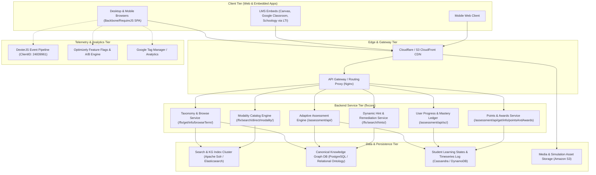
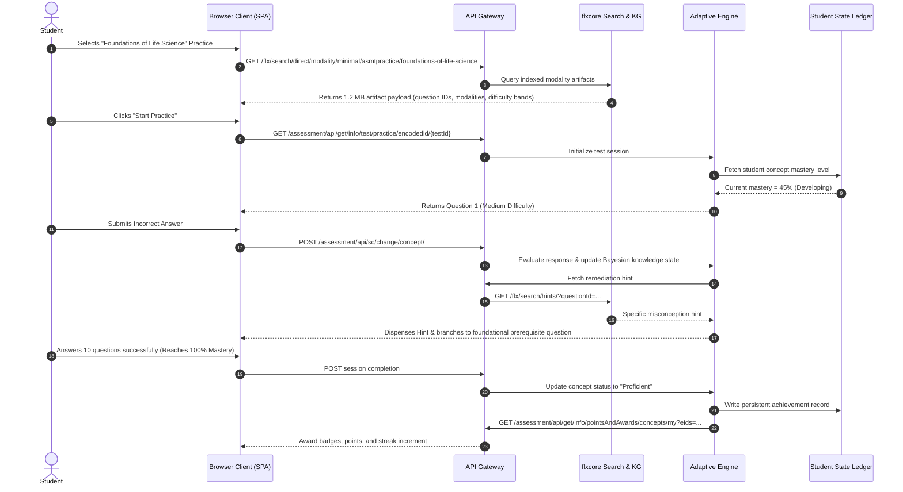

# CK-12 Overall System Architecture

This document provides a comprehensive reverse-engineered architectural specification of the **CK-12 Foundation platform** (`https://www.ck12.org`), focusing on the assessment and practice subsystems (`/assessment/ui/browse/practice/`).

---

## 1. System Topology Overview

CK-12 operates as a distributed, high-scale digital learning and adaptive assessment platform. The architecture is organized around the **FlexBook Core (`flxcore`)** platform, decoupling static content delivery, ontology search, user analytics, and the real-time adaptive assessment state machine.



---

## 2. Component Deconstruction

### 2.1 Client Tier: The Assessment SPA
* **Technology Stack**:
  - Module Loader: **RequireJS** (`require.js`) for AMD dynamic bundle loading.
  - Framework: **Backbone.js** (Models, Collections, Views) with **Underscore.js** templating (`<%= subjectName %>`, `<%= branch %>`).
  - Layout Engine: **Foundation Responsive CSS Grid** (`medium-12 large-12 columns`).
  - Core Bundles:
    - `config-bundle.js`: Global configuration and preview image maps.
    - `browse-bundle.js` (174 KB): UI controller for subject trees, concept filters, and pagination.
    - `browse-vendors-bundle.js`: Third-party vendor dependencies (jQuery, lodash/underscore, UI helpers).
    - `dexterScriptConfig.js`: Internal tracking instrumentation.
* **Client Routing & Initialization**:
  - When navigating to `/assessment/ui/browse/practice/{subject}/?topicHandle={topic}`, the SPA parses the path and URL query parameters.
  - It triggers parallel asynchronous fetches:
    1. Taxonomy metadata (`/flx/get/info/browseTerm/descendants/{subject}`)
    2. Modality artifacts (`/flx/search/direct/modality/minimal/asmtpractice/{topic}`)
    3. User profile & mastery stats (`/assessment/api/get/info/my`)

### 2.2 Backend Tier: `flxcore` (FlexBook Core Platform)
* **API Signature & Origin**:
  - Responses declare their source in the header metadata: `{"source": "flxcoreExt-25-219", "status": 2006, "QTime": 0}`.
  - The `QTime` parameter confirms that read queries pass through an indexed search engine (Apache Solr or Elasticsearch) rather than hitting relational tables directly.
* **Key Microservices**:
  1. **Taxonomy & Browse Engine**: Serves the hierarchically encoded subject-branch-topic tree (e.g., `SCI.LSC.100`).
  2. **Modality Search Service**: Dispatches all learning modalities bound to a concept.
  3. **Adaptive Test Controller**: Manages student test session lifecycle, dynamically serving questions based on current running mastery.
  4. **Remediation & Hint Engine**: Evaluates student incorrect answers in real time to dispense targeted hints or trigger concept branching.

---

## 3. Data Flow & Adaptive Practice Lifecycle



---

## 4. Telemetry, Analytics, and A/B Testing

1. **DexterJS**:
   - CK-12's proprietary behavioral event logger.
   - Script: `/media/dexterjs/dexterjs.min.js`.
   - Initialized as:
     ```javascript
     window.dexterjs.set('config', {
       clientID: 24839961,
       declarativePlugin: { enabled: true, additionalDomEvents: "touchend" }
     });
     ```
   - Automatically attaches to DOM click/touch events on concepts, modalities, and answer buttons, streaming telemetry back to CK-12 analytics backends.
2. **Optimizely Integration**:
   - Script: `//cdn.optimizely.com/js/28889104.js`.
   - Used for server-side and client-side feature flags, testing question presentation formats, UI layouts, and practice incentives.
3. **Google Tag Manager (GTM)**:
   - Configured only when `!window.assessment_configs.isApp()`. When embedded inside native mobile wrappers or LMS iframes, GTM is suppressed to protect student privacy (COPPA/FERPA compliance).
