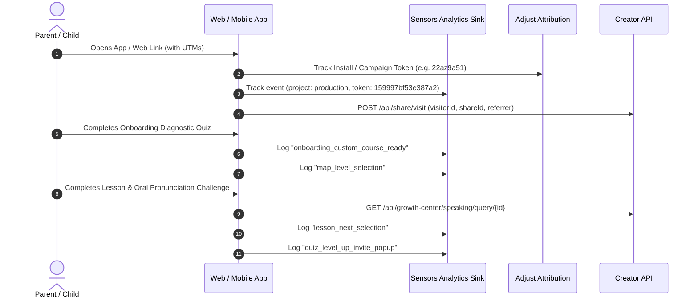

# Giggle Academy Overall System Architecture

This document provides a comprehensive reverse-engineered architectural specification of **Giggle Academy** (`https://giggleacademy.com/`), founded by Changpeng Zhao (CZ) as a free global gamified learning platform for children.

---

## 1. System Topology Overview

Giggle Academy adopts a **Hybrid Headless Architecture**:
* An ultra-fast, multi-lingual **Nuxt 3 web portal** acts as the global marketing, SEO, storybook browser, and printable worksheet hub.
* A high-fidelity, **516 MB native mobile client** (`com.giggleacademy.app`) houses the 3D gamified game engine, animations, and voiceover audio for child learners.
* A centralized **Creator Microservice Platform (`creator.giggleacademy.com`)** acts as the headless CMS and curriculum repository, federating assets across global and regional CDNs.

```mermaid
graph TD
    subgraph ClientTier["Client Layer"]
        WebPortal["Web Portal (Nuxt 3 + Vue 3 SSR)"]
        AndroidApp["Android App (516 MB APK com.giggleacademy.app)"]
        iOSApp["iOS App (App Store ID: 6739128662)"]
    end

    subgraph EdgeCDN["Content Delivery & Gateway Tier"]
        GlobalCDN["Global Asset CDN (static.giggleacademy.com)"]
        ChinaCDN["China Mainland Gateway (creator.qakjukl.net / .com.cn)"]
        AppGateway["API Gateway / Routing Layer"]
    end

    subgraph BackendServices["Backend Microservice Tier"]
        CreatorAPI["Creator Platform (/api/course/listAllWithLevel)"]
        BookService["Public Storybook & Media Service (/api/book/public/)"]
        SpeakingEngine["AI Speech & Oral Language Evaluation (/api/growth-center/speaking/)"]
        ShareService["Referral & Growth Tracking (/api/share/visit)"]
        OTAService["OTA Version & Asset Manifest Service (builds/latest.json)"]
    end

    subgraph TelemetryLayer["Attribution & Telemetry Tier"]
        SensorsData["Sensors Analytics Sink (datasink.sensorsjourney.com)"]
        Adjust["Adjust Mobile Attribution Engine (app.adjust.com)"]
        Tolgee["Tolgee i18n Localization Platform (app.tolgee.io)"]
        Firebase["Firebase Installations & Messaging"]
        vConsole["Tencent vConsole (Runtime Mobile Web Debugger)"]
    end

    WebPortal --> GlobalCDN
    AndroidApp --> GlobalCDN
    iOSApp --> GlobalCDN

    WebPortal --> AppGateway
    AndroidApp --> AppGateway
    iOSApp --> AppGateway

    AppGateway --> CreatorAPI
    AppGateway --> BookService
    AppGateway --> SpeakingEngine
    AppGateway --> ShareService
    AppGateway --> OTAService

    WebPortal -.-> SensorsData
    WebPortal -.-> ShareService
    WebPortal -.-> Tolgee
    WebPortal -.-> vConsole
    AndroidApp -.-> Adjust
    AndroidApp -.-> SensorsData
    AndroidApp -.-> Firebase
```



---

## 2. Component Deconstruction

### 2.1 The Web Client: Nuxt 3 Portal
* **Technology Stack**:
  - Framework: **Nuxt 3** with **Vue 3 Composition API** and Vite bundler.
  - State Management: **Pinia** shallow-reactive stores.
  - Single Core Chunk: `/_nuxt/BToEeydi.js` (1.39 MB).
  - Localization: `nuxt-i18n` with support for **35+ languages** (`en`, `es`, `zh-Hans`, `zh-Hant`, `hi`, `ar`, `fr`, `pt`, `sw`, `bn`, etc.).
  - Mobile Debugger: Embedded **vConsole** logger (`localStorage.getItem('enable-vconsole')`), allowing internal developers to inspect console logs and network traffic directly on mobile devices without USB debugging.
* **Functional Roles**:
  - Discovery & Web Reading: Lets parents and educators preview storybooks (`/story/read/:id`), listen to songs (`/songs`), view phonics flashcards (`/flashcards`), and download printable PDF worksheets (`/worksheets`).
  - Distribution Funnel: Promotes the full gamified mobile application via direct APK download, Google Play Store, and Apple App Store links.

### 2.2 The Native Client: 516 MB Gamified Learning Engine
* **Package Specifications**:
  - Android Package: `com.giggleacademy.app`
  - Release Asset: `GIGGLE-RELEASE-1794052499467.apk` (515,920,385 bytes).
  - iOS App Store: `https://apps.apple.com/app/id6739128662`.
* **Architecture Inferences**:
  - The ~516 MB payload is dominated by cross-platform 3D game engine assets (Unity / Cocos / Godot), pre-rendered animations, phonics soundbanks, and localized speech recognition acoustic models.
  - Operates **offline-first**: Children can progress through levels (`map_level_selection`, `lesson_next_selection`) even when disconnected from the internet.

### 2.3 Headless Backend Microservices (`creator.giggleacademy.com`)
* **Standardized JSON Envelope**:
  All REST APIs return a consistent response envelope:
  ```json
  {
    "code": 200,
    "message": "success",
    "data": { ... }
  }
  ```
* **Key Endpoints**:
  1. `GET /api/course/listAllWithLevel`: Curriculum taxonomy and course difficulty tiering (requires Bearer token authentication).
  2. `GET /api/book/public/topic/{topic}`: Public storybook catalog filtered by category or reading level.
  3. `GET /api/growth-center/speaking/query/{id}`: Speech recognition and oral pronunciation assessment engine.
  4. `POST /api/share/visit`: Tracks referral funnels, campaign UTMs, and visitor session graphs.
  5. `GET /builds/latest.json` & `GET /builds/meta/{hash}`: Over-the-air (OTA) content bundle updates.

### 2.4 Multi-Region Infrastructure & China Redundancy
* To serve mainland China without latency or firewall blocks, Giggle Academy deploys mirrored infrastructure:
  - Global Creator Origin: `https://creator.giggleacademy.com`
  - China Creator Origin: `https://creator.giggleacademy.com.cn` and `https://creator.qakjukl.net`
  - Geo-IP Routing: Uses `https://ipapi.co/json/` on client boot to detect regional location and route to the optimal API host.

---

## 3. Telemetry, Tracking & Localization Pipelines



1. **Sensors Analytics (`sensorsjourney.com`)**:
   - Enterprise event tracking for funnels, retention, and learning milestones (`map_level_selection`, `lesson_next_selection`, `lesson_exit_retain_popup`, `quiz_level_up_invite_popup`).
2. **Adjust Attribution (`app.adjust.com`)**:
   - Deep-linking and ad/social referral attribution tracking.
3. **Tolgee (`app.tolgee.io`)**:
   - Real-time collaborative localization platform used by content creators to translate stories, songs, and UI strings across 35+ languages.
