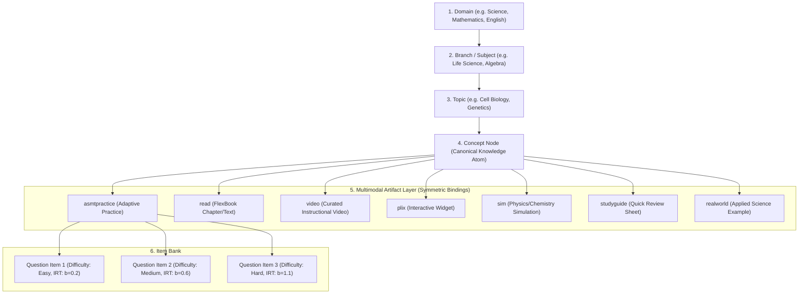
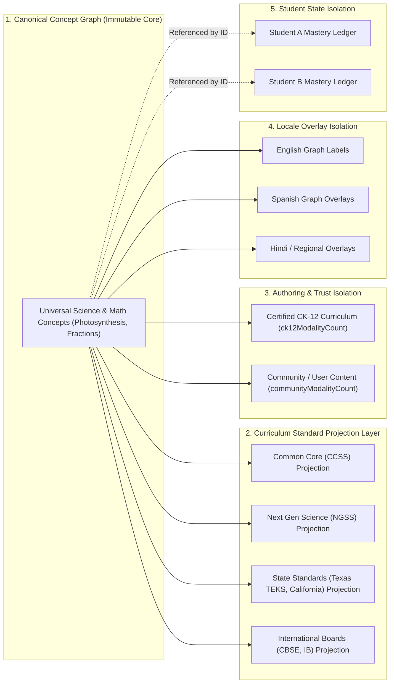

# CK-12 Knowledge Graph System & Isolation Architecture

This document breaks down the structure, data models, relationship semantics, and multi-dimensional isolation strategies of the **CK-12 Knowledge Graph (KG)** based on empirical extraction from `flxcore` endpoints.

---

## 1. Knowledge Graph Ontology & Node Hierarchy

The CK-12 Knowledge Graph is structured as a hierarchical **Directed Acyclic Graph (DAG)** connecting educational taxonomy, learning modalities, and discrete assessment items.



### 1.1 Hierarchical Encoded Identifiers (EIDs)
CK-12 uses a strict namespace-encoded identifier system for all nodes in the ontology tree:
* **Format**: `{DOMAIN}.{BRANCH}.{TOPIC_CODE}.{CONCEPT_CODE}`
* **Examples observed in network payloads**:
  - `SCI`: Domain (Science)
  - `SCI.LSC`: Branch (Life Science)
  - `SCI.LSC.100`: Topic (Introduction to Life Science)
  - `SCI.LSC.200`: Topic (Cell Biology in Life Science)
  - `SCI.LSC.300`: Topic (Molecular Biology and Genetics)
  - `SCI.LSC.400`: Topic (Evolution)
  - `SCI.LSC.500`: Topic (Ecology)

### 1.2 The Concept as the Central Atomic Hub
In CK-12, a "Concept" is the core cognitive atom. Rather than authoring a textbook page or a quiz in isolation, all content is authored as **Modalities** bound to a specific Concept ID:
```json
{
  "conceptId": 40344,
  "conceptHandle": "cell-biology-in-life-science",
  "encodedID": "SCI.LSC.200",
  "name": "Cell Biology",
  "modalities": {
    "asmtpractice": { "id": "asmt_78129", "itemCount": 42 },
    "read": { "id": "read_3190", "url": "/book/ck-12-life-science/section/2.1/" },
    "video": { "id": "vid_9011", "duration": 340 },
    "plix": { "id": "plix_441", "title": "Cell Membrane Fluidity" },
    "sim": { "id": "sim_120", "title": "Cellular Respiration Sim" }
  }
}
```

---

## 2. Knowledge Graph Isolation Strategies

One of CK-12's most important architectural achievements is how it maintains, scales, and isolates its Knowledge Graphs across different dimensions.



### 2.1 Isolation of Curriculum Standards from Core Concepts (Cross-walk / Projection Architecture)
* **The Problem**: Educational standards (NGSS, Common Core, Texas TEKS, Cambridge, CBSE) frequently change, disagree on grade levels, and reorder topics. Storing standards directly as the graph hierarchy would cause fragmentation and breaking changes whenever a state updates its curriculum.
* **CK-12's Solution**:
  - The **Canonical Knowledge Graph** contains purely scientific and mathematical truth (e.g., *Mitosis*, *Law of Conservation of Mass*, *Pythagorean Theorem*) with language-agnostic UUIDs.
  - Standards exist as an **External Alignment Layer** (projections). An alignment is simply a directed relationship:
    `[Standard Node: NGSS-MS-LS1-1] --ALIGNED_TO--> [Concept Node: Cell Structure (SCI.LSC.201)]`
  - When California or Texas changes a standard, **zero concept nodes or assessment items are altered**. Only the alignment edges in the projection table are updated.

### 2.2 Community Authoring vs. Certified Master KG Isolation
* **The Problem**: Teachers and external educators create custom FlexBooks, questions, and chapters. If community content were merged into the main graph, low-quality or inaccurate questions would degrade the adaptive engine.
* **CK-12's Solution**:
  - In every API response, CK-12 strictly segregates:
    - `ck12ModalityCount`: Officially vetted, peer-reviewed curriculum items used by the adaptive assessment engine.
    - `communityModalityCount`: User-generated FlexBooks, local school district quizzes, and teacher forks.
  - The adaptive practice engine queries *only* `ck12ModalityCount` items by default, while search interfaces allow users to toggle community-authored resources.

### 2.3 Subject & Domain Graph Partitioning
* **The Problem**: Traversing a monolithic graph containing millions of items across Biology, Chemistry, Calculus, and Earth Science causes memory bloat and cross-domain pollution.
* **CK-12's Solution**:
  - Graphs are partitioned at the `Domain` and `Branch` levels (`SCI.LSC`, `MATH.ALG`, `SCI.CHM`).
  - Prerequisite edges are scoped: intra-branch prerequisites (e.g. *Cell Division* requiring *Cell Organelles*) are resolved locally. Inter-branch dependencies (e.g. *Biochemistry* requiring *Chemical Bonding* from Chemistry) use explicit cross-branch bridge pointers rather than deep full-graph traversals.

### 2.4 Localization & Language Overlay Isolation
* **The Problem**: Duplicating entire knowledge graphs for every language (English, Spanish, Hindi, etc.) creates synchronization drift when questions or concepts are updated.
* **CK-12's Solution**:
  - Node identity, topology, and prerequisite edges are language-neutral.
  - Translations are stored as **Localization Overlays** indexed by `(concept_id, locale)`.
  - In `browse-bundle.js`, the client queries `englishbranches` as the canonical reference, applying localized string catalogs on top.

### 2.5 Stateless Knowledge Graph vs. Stateful Student State Isolation
* **The Problem**: Conflating question content with student attempts creates complex database locks and prevents caching.
* **CK-12's Solution**:
  - The Knowledge Graph and question banks are **100% stateless, immutable, and aggressively cached** at CDN edges and Solr search replicas (`/flx/search/direct/...`).
  - Student learning state (attempts, streaks, Bayesian mastery scores) is stored in a separate timeseries ledger (`/assessment/api/sc/`). The assessment engine queries the student state, calculates the target difficulty, and retrieves matching question IDs from the immutable cache.
