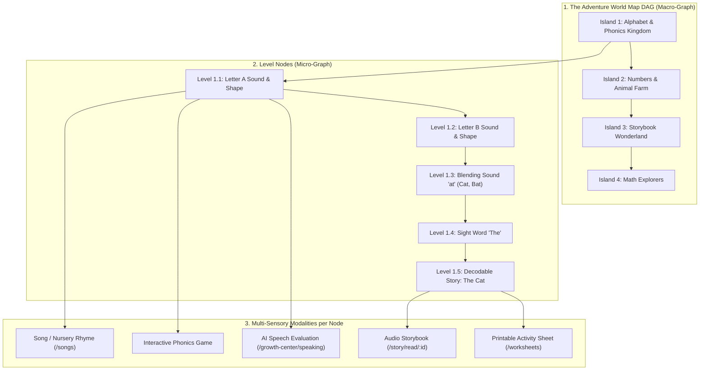
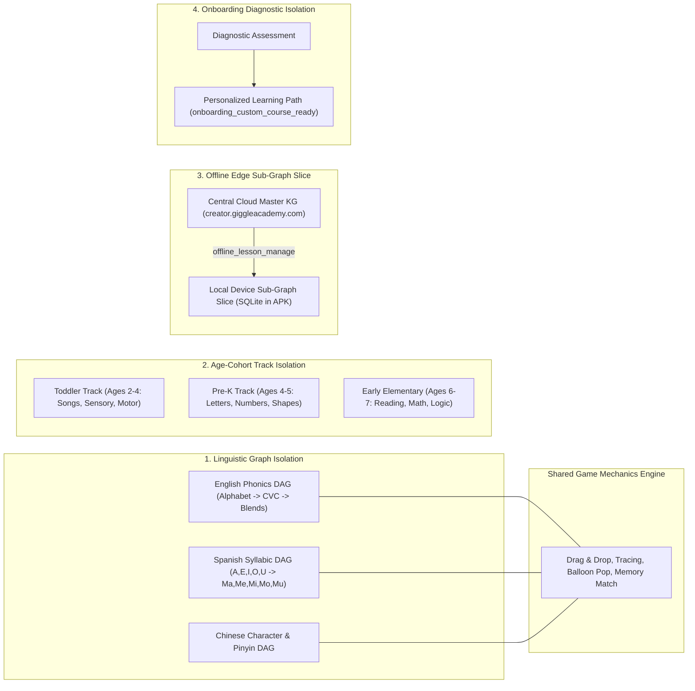

# Giggle Academy Knowledge Graph System & Isolation Architecture

This document analyzes the learning graph structure, developmental skill ontologies, and multi-layered isolation mechanisms of **Giggle Academy** based on empirical reverse engineering of client bundles, API endpoints, and event telemetry.

---

## 1. Learning Graph Structure: The Adventure Map DAG

Unlike CK-12's academic textbook taxonomy, Giggle Academy transforms its Knowledge Graph into a **Gamified Journey / Adventure Map Directed Acyclic Graph (DAG)**.

### 1.1 The Developmental Skill Ontologies

Giggle Academy partitions early childhood knowledge into three distinct developmental pillars:

1. **Early Literacy & Phonics Graph**:
   - *Stage 1 (Phonemic Awareness)*: Sound discrimination, rhyming, beginning sounds.
   - *Stage 2 (Letter-Sound Correspondence)*: Single consonants and short vowels (A, B, C...).
   - *Stage 3 (CVC Blending)*: Consonant-Vowel-Consonant words (cat, dog, pen, sun).
   - *Stage 4 (High-Frequency Sight Words)*: Non-phonetic words (the, was, you, said).
   - *Stage 5 (Decodable Reading & Fluency)*: Contextual children's storybooks with real-time word highlighting.
   - *Stage 6 (Oral Expression)*: Speech recognition verification via `/api/growth-center/speaking/query/{id}`.

2. **Early Numeracy & Logic Graph**:
   - *Stage 1 (Subitizing & One-to-One Correspondence)*: Counting up to 5 with visual objects.
   - *Stage 2 (Numeral Recognition & Writing)*: Associating digits `0-9` with quantities.
   - *Stage 3 (Basic Operations & Comparison)*: Bigger/smaller, addition within 10 using animated physical metaphors.
   - *Stage 4 (Spatial & Geometry)*: Shapes, patterns, sorting.

3. **Life Skills, Habits & Socio-Emotional Graph**:
   - Hygiene, manners, sharing, bedtime routines, and safety taught through musical rhymes and animated cartoons.

---

## 2. Knowledge Graph Isolation Strategies

Teaching children across diverse cultures, languages, and developmental ages requires sophisticated graph isolation.

### 2.1 Linguistic & Phonics Graph Isolation
* **The Problem**: Phonics cannot be translated literally between languages. English is an alphabetic language relying on phonemes and digraphs (`sh`, `ch`, `th`). Spanish is syllable-timed and taught via open syllables (`ma`, `me`, `mi`, `mo`, `mu`). Chinese uses logographic characters with Pinyin tones. Attempting to use a single unified graph with string translations would result in nonsensical phonics lessons.
* **Giggle Academy's Solution**:
  - **Complete Linguistic DAG Isolation**: Each language has its own independent Knowledge Graph topology.
  - **Shared Interaction Mechanics**: While the curriculum DAG is completely isolated per language, the interactive *game engines* (tracing letters, matching pairs, balloon-popping words, rhythm-tapping songs) are reusable components parameterized by the language-specific graph nodes.

### 2.2 Age-Cohort & Developmental Milestone Isolation
* **The Problem**: Presenting a 3-year-old with multi-digit subtraction or abstract grammar causes frustration, while presenting an 8-year-old with single-letter matching causes boredom.
* **Giggle Academy's Solution**:
  - The master graph is strictly partitioned into **Developmental Tracks**:
    - `Track 1 (Toddler, 2-4)`: Sensory perception, colors, animal sounds, nursery rhymes.
    - `Track 2 (Preschool, 4-5)`: Alphabet, single phonemes, numbers 1-20, shapes.
    - `Track 3 (Early Elementary, 6-7)`: Decodable reading, sentences, addition/subtraction.
  - Prerequisite edges cannot cross track boundaries upwards without passing a formal **Level-Up Milestone Quiz** (`quiz_level_up_invite_popup`).

### 2.3 Edge Sub-Graph Slices & Offline-First Isolation
* **The Problem**: Children frequently play on tablets in offline environments (in vehicles, flights, or developing regions with intermittent internet). A cloud-dependent graph traversal would break the gameplay experience.
* **Giggle Academy's Solution**:
  - The full curriculum is authored and stored centrally on `creator.giggleacademy.com`.
  - When the app is connected, the client downloads a bounded **Sub-Graph Slice** via `offline_lesson_manage`.
  - This slice contains:
    1. A localized SQLite database specifying the next 10-20 level nodes, unlock conditions, and prerequisite states.
    2. Associated multimedia assets (audio phonics files, sprite sheets, and animations).
  - The local game loop operates entirely on this self-contained sub-graph slice. When network connectivity is restored, student milestone events are batched and synced to the cloud.

### 2.4 Diagnostic Onboarding & Personalized Path Isolation
* **The Problem**: Children enter the app with wildly varying skill levels (some already know the alphabet at age 3, others do not at age 5).
* **Giggle Academy's Solution**:
  - On first launch, a brief interactive diagnostic game evaluates baseline literacy and numeracy.
  - The engine fires the telemetry event `onboarding_custom_course_ready`.
  - Instead of forcing the child into Level 1.1 or modifying the global curriculum, the engine constructs a **Virtual Custom Path** by unlocking and filtering appropriate nodes from the master DAG, providing an immediate tailored trajectory.
