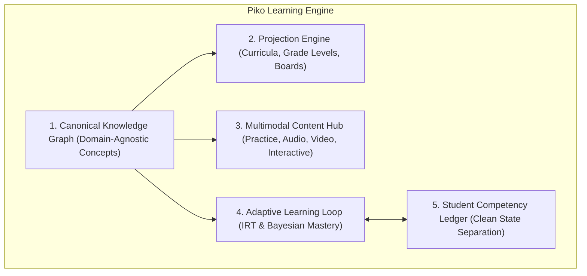
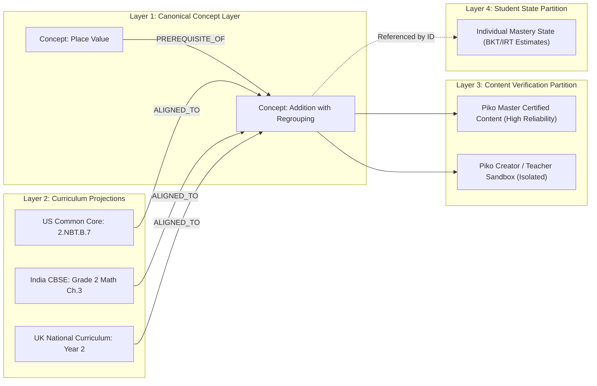

# Architectural Blueprint for Piko: Key Takeaways from CK-12

This document synthesizes the reverse-engineered insights from CK-12 into concrete, implementation-ready architectural recommendations, schemas, and design patterns for **Piko**.

---

## 1. Core Architectural Pillars for Piko



### 1.1 The "Concept-First" Multimodal Content Model
* **The Antipattern to Avoid**: Organizing content as a tree of course chapters and attaching quizzes to pages. This tightly couples quizzes to specific textbook layouts and breaks cross-curriculum reuse.
* **The Piko Pattern**:
  - Treat **Concepts** as the atomic building blocks of the platform.
  - Every Concept node in Piko must have symmetric bindings to multimodal assets:
    - `micro_lesson`: A 2-minute bite-sized visual/interactive explainer.
    - `adaptive_practice`: A calibrated item bank with parameterized questions.
    - `interactive_widget`: Rich gamified manipulation tool (like CK-12's PLIX).
    - `summary_card`: Quick reference cheat sheet.
  - When Piko launches a new course or grade level, educators simply select and arrange existing Concept IDs without authoring duplicate questions.

### 1.2 Encoded Namespace Identifiers (EIDs)
Adopt CK-12's hierarchical identifier structure for all Piko nodes to ensure fast hierarchical filtering and index partitioning:
* `PIKO.MATH.NUM.101` (Math -> Numeracy -> Place Value)
* `PIKO.SCI.BIO.205` (Science -> Biology -> Photosynthesis)
* `PIKO.LANG.PHON.012` (Language -> Phonics -> Digraphs /sh/)

---

## 2. Knowledge Graph Isolation Design for Piko

To scale Piko cleanly across multiple countries, languages, and school boards, implement CK-12's 4-layer isolation architecture:



### 2.1 Standard & Curriculum Isolation (Projection Layer)
* Keep Piko's concept ontology completely decoupled from state and national educational standards.
* Create a `curriculum_standards_projections` table. When school districts or international users require compliance with a specific curriculum, query the projection mapping to render the custom table of contents dynamically.

### 2.2 Content Verification Boundary (Certified vs. Community)
* Follow CK-12's `ck12ModalityCount` vs `communityModalityCount` isolation.
* Items authored by community members, teachers, or AI generation pipelines must enter a `SANDBOX` partition. Only items passing human expert review or verified high-confidence automated validation get promoted to the `CERTIFIED` partition used by the adaptive assessment engine.

### 2.3 Stateless Knowledge Graph Caching
* Store Piko's Knowledge Graph nodes, edges, and question artifacts in an immutable, read-heavy data store (e.g. Postgres with Redis / Elasticsearch read replicas).
* Edge caches (Cloudflare Workers / CDN) can cache full topic modality payloads for weeks with TTLs, drastically reducing backend compute costs.

---

## 3. Concrete Database Schemas for Piko

### 3.1 Canonical Concept & Prerequisite Schema (PostgreSQL / Relational)

```sql
-- 1. Canonical Concepts Table
CREATE TABLE piko_concepts (
    concept_id UUID PRIMARY KEY DEFAULT gen_random_uuid(),
    encoded_id VARCHAR(64) UNIQUE NOT NULL, -- e.g. 'PIKO.MATH.NUM.101'
    domain VARCHAR(32) NOT NULL,            -- e.g. 'MATH'
    branch VARCHAR(32) NOT NULL,            -- e.g. 'NUMERACY'
    topic_handle VARCHAR(64) NOT NULL,      -- e.g. 'place-value'
    canonical_name VARCHAR(128) NOT NULL,
    description TEXT,
    created_at TIMESTAMPTZ DEFAULT NOW(),
    updated_at TIMESTAMPTZ DEFAULT NOW()
);

-- 2. Prerequisite & Graph Edge Table
CREATE TABLE piko_concept_prerequisites (
    prerequisite_id UUID PRIMARY KEY DEFAULT gen_random_uuid(),
    source_concept_id UUID NOT NULL REFERENCES piko_concepts(concept_id) ON DELETE CASCADE,
    target_concept_id UUID NOT NULL REFERENCES piko_concepts(concept_id) ON DELETE CASCADE,
    edge_type VARCHAR(32) NOT NULL DEFAULT 'STRICT_PREREQUISITE', -- 'STRICT_PREREQUISITE', 'RECOMMENDED', 'RELATED'
    strength_weight NUMERIC(3, 2) DEFAULT 1.00,
    CONSTRAINT unique_concept_edge UNIQUE (source_concept_id, target_concept_id)
);

-- 3. Multimodal Artifact Binding Table
CREATE TABLE piko_modality_artifacts (
    artifact_id UUID PRIMARY KEY DEFAULT gen_random_uuid(),
    concept_id UUID NOT NULL REFERENCES piko_concepts(concept_id) ON DELETE CASCADE,
    modality_type VARCHAR(32) NOT NULL, -- 'PRACTICE', 'READ', 'VIDEO', 'INTERACTIVE', 'FLASHCARD'
    content_payload JSONB NOT NULL,
    verification_tier VARCHAR(16) NOT NULL DEFAULT 'COMMUNITY', -- 'CERTIFIED', 'COMMUNITY', 'AI_DRAFT'
    difficulty_level NUMERIC(3, 2) DEFAULT 0.50,               -- IRT difficulty parameter 'b'
    is_active BOOLEAN DEFAULT TRUE,
    created_at TIMESTAMPTZ DEFAULT NOW()
);

-- 4. External Curriculum Standard Projections Table
CREATE TABLE piko_curriculum_projections (
    projection_id UUID PRIMARY KEY DEFAULT gen_random_uuid(),
    standard_framework VARCHAR(32) NOT NULL, -- 'US_CCSS', 'US_NGSS', 'IN_CBSE', 'UK_NC'
    standard_code VARCHAR(64) NOT NULL,      -- e.g. 'CCSS.MATH.CONTENT.2.NBT.B.7'
    standard_title VARCHAR(256) NOT NULL,
    grade_level VARCHAR(16) NOT NULL,
    concept_id UUID NOT NULL REFERENCES piko_concepts(concept_id) ON DELETE CASCADE,
    alignment_strength VARCHAR(16) DEFAULT 'DIRECT', -- 'DIRECT', 'PARTIAL', 'EXTENDED'
    CONSTRAINT unique_standard_mapping UNIQUE (standard_framework, standard_code, concept_id)
);
```

### 3.2 Student Mastery State Ledger Schema

```sql
-- 5. Student Competency Ledger (Stateless Separation)
CREATE TABLE piko_student_concept_mastery (
    mastery_id UUID PRIMARY KEY DEFAULT gen_random_uuid(),
    user_id UUID NOT NULL,
    concept_id UUID NOT NULL REFERENCES piko_concepts(concept_id),
    mastery_score NUMERIC(5, 4) DEFAULT 0.0000, -- Probability of Mastery (0.0 to 1.0)
    mastery_status VARCHAR(16) DEFAULT 'NOT_STARTED', -- 'NOT_STARTED', 'LEARNING', 'PROFICIENT', 'MASTERED'
    total_attempts INT DEFAULT 0,
    consecutive_correct INT DEFAULT 0,
    last_practiced_at TIMESTAMPTZ,
    updated_at TIMESTAMPTZ DEFAULT NOW(),
    CONSTRAINT unique_user_concept UNIQUE (user_id, concept_id)
);
```

---

## 4. Adaptive Practice Engine Algorithm for Piko

Inspired by CK-12's `/assessment/api/sc/change/concept/`:

```python
class PikoAdaptiveAssessmentEngine:
    def __init__(self, user_id: str, concept_id: str):
        self.user_id = user_id
        self.concept_id = concept_id

    def process_answer(self, question_id: str, is_correct: bool, time_spent_sec: float):
        # 1. Fetch current Bayesian Knowledge Tracing (BKT) parameters
        prior_p_mastery = self.get_student_mastery(self.user_id, self.concept_id)
        
        # BKT Model Constants
        P_TRANSIT = 0.10   # Probability of learning on this attempt
        P_SLIP = 0.10      # Probability of making a mistake despite knowing
        P_GUESS = 0.20     # Probability of guessing correctly

        # 2. Bayesian Update
        if is_correct:
            p_evidence = (prior_p_mastery * (1 - P_SLIP)) / (
                prior_p_mastery * (1 - P_SLIP) + (1 - prior_p_mastery) * P_GUESS
            )
        else:
            p_evidence = (prior_p_mastery * P_SLIP) / (
                prior_p_mastery * P_SLIP + (1 - prior_p_mastery) * (1 - P_GUESS)
            )

        new_p_mastery = p_evidence + (1 - p_evidence) * P_TRANSIT
        self.update_student_mastery(self.user_id, self.concept_id, new_p_mastery)

        # 3. Dynamic Remediation Routing (CK-12 pattern)
        if not is_correct and new_p_mastery < 0.35:
            # Check if student is struggling repeatedly -> Branch to prerequisite concept
            prereq = self.find_highest_impact_prerequisite(self.concept_id)
            if prereq:
                return {
                    "action": "BRANCH_PREREQUISITE",
                    "target_concept_id": prereq["concept_id"],
                    "remediation_hint": self.fetch_targeted_hint(question_id)
                }

        # 4. Select Next Question calibrated to new mastery level
        next_difficulty = "EASY" if new_p_mastery < 0.40 else ("MEDIUM" if new_p_mastery < 0.75 else "HARD")
        next_question = self.sample_item_from_bank(self.concept_id, next_difficulty)

        return {
            "action": "CONTINUE_PRACTICE",
            "current_mastery": round(new_p_mastery, 4),
            "next_question": next_question
        }
```
