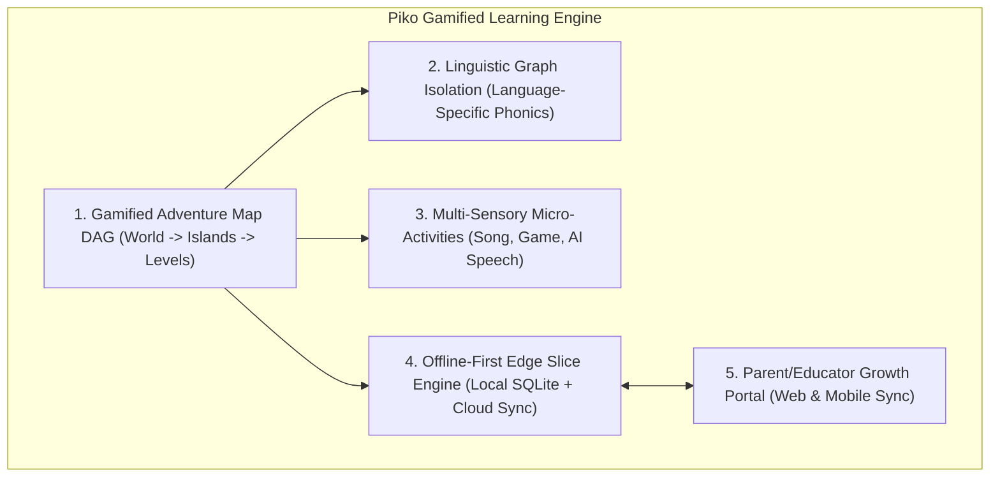
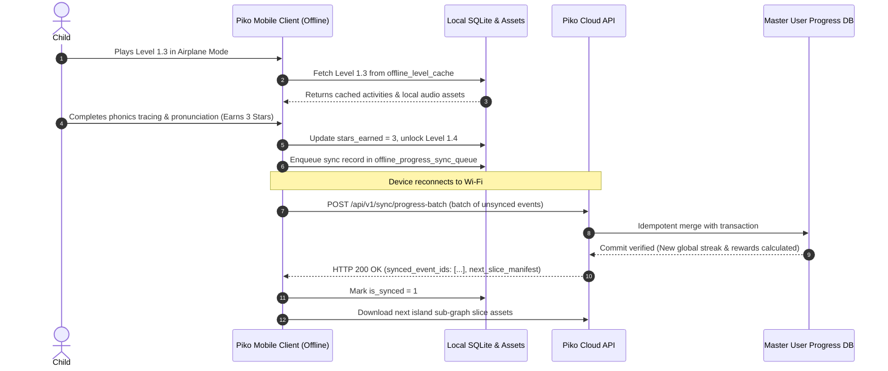

# Architectural Blueprint for Piko: Key Takeaways from Giggle Academy

This document outlines actionable system architectures, data models, game-based learning graph schemas, and offline synchronization strategies for **Piko**, derived from the reverse engineering of **Giggle Academy**.

---

## 1. Core Architectural Pillars for Piko



### 1.1 The World Map Adventure Path
* **The Piko Pattern**:
  - For young learners (ages 3-10), avoid raw textbook tables of contents. Linearize the underlying Knowledge Graph into an **Adventure World Map**.
  - A node on the world map represents a discrete milestone (e.g., *Letter S Sound*, *Counting to 10*, *Colors*).
  - Completing a node triggers celebrations, sound effects, and unlocks adjacent connected nodes on the DAG.

### 1.2 Linguistic Graph Isolation for Phonics & Early Language
* When building language modules for Piko (English, Spanish, Hindi, etc.):
  - **Do NOT attempt to translate phonics graphs literally**. English requires phoneme-grapheme correspondences; Spanish requires syllabic progressions; tonal languages require pitch discrimination.
  - Create **isolated linguistic knowledge graphs** for each target language.
  - Build **reusable game mechanics** (e.g., balloon popping, card matching, character tracing, audio pronunciation grading) that ingest the language-specific graph nodes as configuration parameters.

### 1.3 Offline-First Edge Architecture
* Like Giggle Academy's `offline_lesson_manage`:
  - Children cannot be assumed to have uninterrupted internet connectivity.
  - Piko must operate on a **Local Sub-Graph Slice** model: the client device pre-caches the current island/unit (the next 15-20 activities + audio/video assets) into local storage (SQLite / WatermelonDB / Realm).
  - The app plays smoothly 100% offline. Progress is logged locally and synced with an idempotent merge protocol upon reconnection.

---

## 2. Concrete Database Schemas for Piko (Early Learning & Gamification)

### 2.1 Adventure World Map & Gamified Level Schema (PostgreSQL)

```sql
-- 1. Adventure Worlds / Islands
CREATE TABLE piko_adventure_worlds (
    world_id UUID PRIMARY KEY DEFAULT gen_random_uuid(),
    world_code VARCHAR(32) UNIQUE NOT NULL, -- e.g. 'ISLAND_ALPHABET', 'ISLAND_NUMBERS'
    world_title VARCHAR(128) NOT NULL,
    theme_assets JSONB NOT NULL,            -- Background sprites, ambient audio, map coordinates
    order_index INT NOT NULL,
    is_active BOOLEAN DEFAULT TRUE
);

-- 2. Level Nodes on the Adventure Map
CREATE TABLE piko_adventure_levels (
    level_id UUID PRIMARY KEY DEFAULT gen_random_uuid(),
    world_id UUID NOT NULL REFERENCES piko_adventure_worlds(world_id) ON DELETE CASCADE,
    level_code VARCHAR(32) NOT NULL,        -- e.g. 'LVL_1_1'
    title VARCHAR(128) NOT NULL,
    concept_id UUID NOT NULL,               -- Links to Canonical Concept Table
    language_code VARCHAR(16) NOT NULL,     -- 'en', 'es', 'hi', 'zh' (Linguistic isolation)
    min_age INT DEFAULT 3,
    max_age INT DEFAULT 7,
    map_coordinates JSONB NOT NULL,         -- { "x": 120, "y": 450 }
    order_index INT NOT NULL,
    CONSTRAINT unique_world_level UNIQUE (world_id, level_code, language_code)
);

-- 3. Adventure Map Unlock Dependency Edges
CREATE TABLE piko_level_dependencies (
    dependency_id UUID PRIMARY KEY DEFAULT gen_random_uuid(),
    parent_level_id UUID NOT NULL REFERENCES piko_adventure_levels(level_id) ON DELETE CASCADE,
    child_level_id UUID NOT NULL REFERENCES piko_adventure_levels(level_id) ON DELETE CASCADE,
    unlock_condition JSONB NOT NULL,        -- { "min_stars": 2, "required_score": 80 }
    CONSTRAINT unique_level_edge UNIQUE (parent_level_id, child_level_id)
);

-- 4. Multi-Sensory Activity Payloads per Level
CREATE TABLE piko_level_activities (
    activity_id UUID PRIMARY KEY DEFAULT gen_random_uuid(),
    level_id UUID NOT NULL REFERENCES piko_adventure_levels(level_id) ON DELETE CASCADE,
    activity_type VARCHAR(32) NOT NULL,     -- 'SONG_VIDEO', 'TRACING_GAME', 'VOICE_REPEAT', 'STORYBOOK'
    activity_config JSONB NOT NULL,         -- Parameters for the interactive game engine
    media_asset_urls JSONB NOT NULL,        -- Audio files, sprite sheets, voiceover cues
    duration_estimate_sec INT DEFAULT 120,
    order_index INT NOT NULL
);
```

### 2.2 Client-Side Offline Sub-Graph Cache Schema (SQLite on Device)

```sql
-- Client SQLite Schema for Offline-First Play (Piko Mobile Client)
CREATE TABLE offline_level_cache (
    level_id TEXT PRIMARY KEY,
    world_id TEXT NOT NULL,
    level_code TEXT NOT NULL,
    title TEXT NOT NULL,
    is_unlocked INTEGER DEFAULT 0,
    stars_earned INTEGER DEFAULT 0,
    high_score INTEGER DEFAULT 0,
    activities_json TEXT NOT NULL, -- Serialized activity configs and local asset file paths
    last_completed_at INTEGER
);

CREATE TABLE offline_progress_sync_queue (
    event_id TEXT PRIMARY KEY,
    user_id TEXT NOT NULL,
    level_id TEXT NOT NULL,
    event_type TEXT NOT NULL,      -- 'LEVEL_START', 'ACTIVITY_COMPLETE', 'STAR_EARNED'
    payload_json TEXT NOT NULL,
    timestamp INTEGER NOT NULL,
    is_synced INTEGER DEFAULT 0
);
```

---

## 3. Piko Offline-to-Cloud Sync Protocol



---

## 4. Key Lessons Summary for Piko

| Feature Area | Giggle Academy Architecture | Piko Implementation Recommendation |
| :--- | :--- | :--- |
| **User Interface** | World Adventure Map with Islands | Visual gamified journey map with unlockable milestone pins. |
| **Linguistic Scope** | 35+ locales with dedicated phonics sets | Isolated language learning graphs; never translate phonics literally. |
| **Activity Length** | Micro-activities (1 to 2 minutes) | Keep activities under 3 minutes to match children's attention spans. |
| **Connectivity** | 516 MB APK with offline-first local cache | Bundle starter worlds in app; pre-fetch next island in background. |
| **AI Assessment** | Oral pronunciation assessment endpoint | Implement on-device speech-to-text / acoustic matching for phonics. |
| **Parent Trust** | Strict child-safe isolation, zero ads | COPPA/FERPA compliant, zero third-party behavioral ads, parent PIN gate. |
