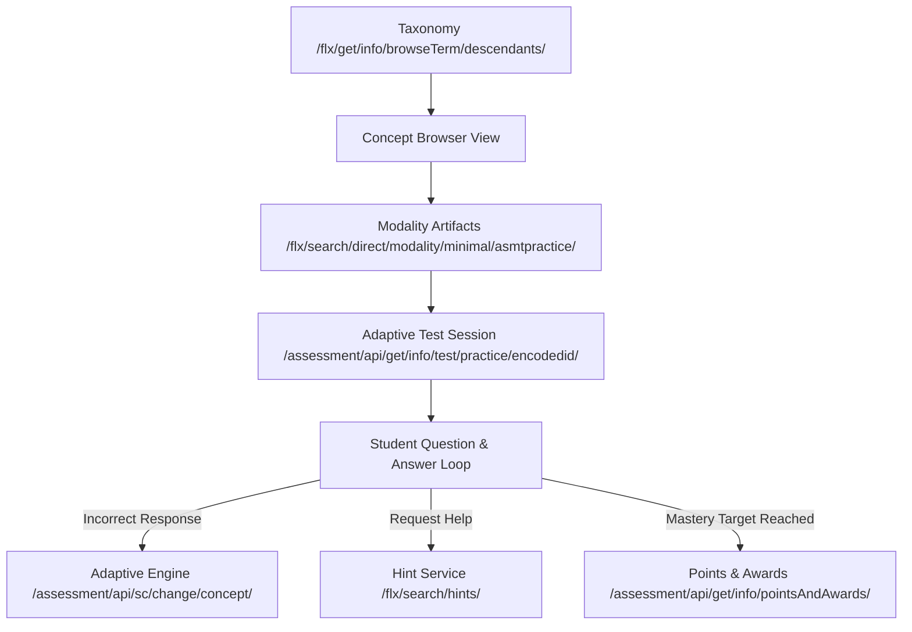

# REA Analysis: CK-12 Assessment & Practice Engine

**Target Origin**: `https://www.ck12.org/assessment/ui/browse/practice/life-science/?topicHandle=foundations-of-life-science`  
**Methodology**: Reverse Engineer Anything (REA) Guidelines  

---

## Detailed Architectural & Knowledge Graph Documentation
For deep-dive technical specifications and blueprints designed for **Piko**, consult:
1. [CK-12 Overall System Architecture](../../docs/architecture/ck12-overall-architecture.md): Full deconstruction of client SPA, API gateway, `flxcore` backend, adaptive assessment loops, caching, and telemetry.
2. [CK-12 Knowledge Graph System & Isolation Architecture](../../docs/knowledge-graph/ck12-knowledge-graph-system.md): In-depth breakdown of the 6-tier ontology (Domain -> Branch -> Topic -> Concept -> Modality -> Item Bank) and the 5 isolation dimensions (Standards Projections, Community vs Core, Subject Partitioning, Localization Overlays, and Stateless Graph vs State Ledger).
3. [Architectural Blueprint for Piko: Key Takeaways from CK-12](../../docs/piko-blueprint/piko-takeaways-from-ck12.md): Concrete database schemas, BKT adaptive practice algorithms, and engineering patterns tailored for Piko.

---

## 1. Observations (Empirical Evidence)

### 1.1 Architecture & Runtime
- **Frontend Stack**: Hybrid architecture with Backbone.js Views, Underscore.js / EJS templates, RequireJS module loading, and Foundation CSS responsive grid.
- **Client Bundles**:
  - `ck12AssessmentUIBuild/config-bundle.js`
  - `ck12AssessmentUIBuild/browse-bundle.js` (174 KB)
  - `ck12AssessmentUIBuild/browse-vendors-bundle.js`
  - `public/lib/dexterjs/dexterScriptConfig.js` (DexterJS event dispatcher)
- **Engine Signature**: HTTP responses return the `flxcore` backend identifier:
  `{"source": "flxcoreExt-25-219", "status": 2006, ...}`

### 1.2 Discovered API Endpoints
- **Taxonomy Tree**:
  - `GET /flx/get/info/browseTerm/descendants/life-science` (Branch ID: `24781`, `encodedID: "SCI.LSC"`).
- **Modality & Practice Catalog**:
  - `GET /flx/search/direct/modality/minimal/asmtpractice/{topicHandle}` (Returns ~1.2 MB artifact metadata with question counts, modalities, collections, and difficulty metrics).
- **Practice Assessment Engine**:
  - `GET /assessment/api/get/info/my` (Student user profile, streak data, mastery scores).
  - `GET /assessment/api/get/info/pointsAndAwards/concepts/my?eids=` (Rewards and points per concept).
  - `GET /assessment/api/get/info/test/practice/encodedid/{testId}` (Interactive test session generator).
  - `POST /assessment/api/sc/change/concept/` (Adaptive concept adjustment when a student struggles or excels).
  - `GET /flx/search/hints/` (Adaptive hints for live test questions).

### 1.3 Telemetry & Integrations
- Internal telemetry: `dexterjs.min.js` configured with `clientID: 24839961`.
- Optimizely A/B test suite: `//cdn.optimizely.com/js/28889104.js`.
- Google Tag Manager.

---

## 2. Derivations (Reconstructed Pipeline)

---

## 3. Inferences

- The search and filter backend uses Apache Solr or Elasticsearch clusters exposed through `flxcore` proxies.
- Practice assessments adaptively vary question difficulty based on dynamic item response algorithms executed server-side.

---

## 4. Unknowns

- Proprietary question item banks and internal mathematical difficulty weights are guarded behind authenticated session cookies and not published in client-accessible bundles.
