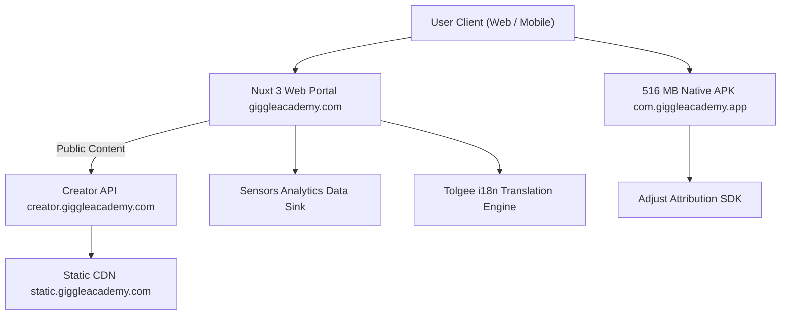

# REA Analysis: Giggle Academy

**Target Origin**: `https://giggleacademy.com/`  
**Methodology**: Reverse Engineer Anything (REA) Guidelines  

---

## 1. Observations (Empirical Evidence)

### 1.1 Architecture & Runtime
- **Frontend Stack**: Modern Nuxt 3 (Vue 3 SSR) with Pinia shallow-reactive stores and Vite-bundled chunks.
- **Client Bundles**:
  - `/_nuxt/BToEeydi.js` (1.39 MB core chunk).
- **Embedded Mobile Debugger**:
  - `localStorage['enable-vconsole']` exposes Tencent vConsole in browser and web views.
- **Microservices & API Origins**:
  - Web Origin: `https://giggleacademy.com`
  - Backend/Creator API: `https://creator.giggleacademy.com`
  - China Regions: `https://creator.giggleacademy.com.cn` and `https://creator.qakjukl.net`
  - CDN Origin: `https://static.giggleacademy.com`

### 1.2 Discovered Endpoints & Protocols
- **Distribution & Android Package**:
  - Android Package Name: `com.giggleacademy.app`
  - iOS App Store ID: `6739128662`
  - Latest APK Endpoint: `GET /api/download/latest-apk?channel=website` -> 302 Redirect to:
    `https://static.giggleacademy.com/app/website/GIGGLE-RELEASE-1794052499467.apk` (~516 MB).
- **Curriculum & Creator Endpoints**:
  - `GET /api/course/listAllWithLevel` (Protected behind Bearer token, returns HTTP 401).
  - `GET /api/book/public/topic/{topic}` (Returns `{ code: 200, message: "success", data: ... }`).
  - `GET /api/growth-center/speaking/query/{id}` (Oral language & speaking evaluation query).
  - `POST /api/share/visit` (Tracks user share, referrer, and telemetry).

### 1.3 Telemetry & Infrastructure
- Sensors Analytics data sink: `https://giggle-pro.datasink.sensorsjourney.com/sa?project=production&token=159997bf53e387a2`
- Adjust mobile attribution tokens (`22az9a51`, `21ddgjar`, `26og2ren`).
- Tolgee localization backend (`app.tolgee.io`).

---

## 2. Derivations (Reconstructed Pipeline)

---

## 3. Inferences

- The 516 MB APK bundle houses a full cross-platform game engine (e.g. Unity or Cocos) containing high-fidelity animations, character models, pre-recorded audio phonics, and offline gamified lesson engines.
- The web app is structured as a Jamstack marketing, SEO, and content viewer hub, serving as the entry funnel into the mobile app ecosystem.

---

## 4. Unknowns

- Cryptographic asset bundle encryption keys and local SQLite user progression schemas embedded inside the APK binary require on-device extraction or Dalvik bytecode reverse engineering via REA's JADX integration.
